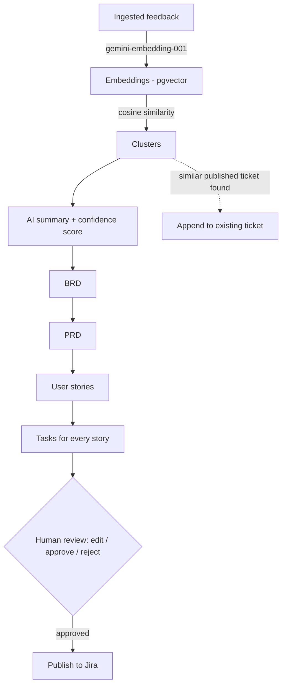

# 🦍 ApeAI — Automated Product Engineering AI

ApeAI turns raw, multi-source user feedback into structured engineering work —
BRDs, PRDs, user stories and technical tasks — with a human review gate before
anything reaches your tracker.

- **Backend:** Node.js 18+ · Express · TypeScript (`backend/`)
- **Frontend:** Next.js 14 (App Router) · Tailwind CSS · TypeScript (`frontend/`)
- **Data:** Supabase (PostgreSQL + pgvector + Auth + Storage)
- **AI:** Google Gemini — `gemini-embedding-001` (768-dim) for embeddings,
  `gemini-2.5-flash-lite` (JSON mode) for generation
- **Publishing:** Jira Cloud (GitHub and Linear are not implemented yet)



---

## How it works



### Layer 1 — Ingestion
Every source is normalized into one `feedback` row (`source`, `author`,
`content`, `timestamp`, `external_id`, `metadata`).

| Source | Endpoint | Auth |
|---|---|---|
| Manual paste | `POST /feedback/manual` | user token |
| CSV upload (≤ 5 MB, needs a `content` column; optional `author`, `source`, `date`) | `POST /feedback/csv` | user token |
| App Store / Google Play | `POST /api/ingestion/appstore` | user token |
| Reddit | `POST /api/ingestion/reddit` | user token |
| Connector simulator (demo data) | `POST /api/ingestion/simulate/:source` | user token |
| Intercom / Zendesk, Fireflies / Zoom, Sentry / PostHog | `POST /api/ingestion/webhooks/*` | webhook (see *Known limitations*) |

Items that carry an `external_id` are de-duplicated per user and source, so
re-sending the same review or re-running the simulator does not create copies.

> The polling connectors (`appStoreClient`, `redditClient`, `sentryClient`,
> `intercomClient`) are **stubs that return mock data** even when credentials
> are configured.

### Layer 2 — Storage
Tables: `feedback`, `embeddings`, `clusters`, `cluster_feedback`, `documents`,
`approvals`, `integrations`, `ticket_links`, `profiles`. Clusters, documents
and integrations belong to a user (`user_id`), and every API call is scoped
to the signed-in user.

Embeddings record the model that produced them. If the embedding model
changes, stale vectors are regenerated automatically on the next clustering
run (vectors from different models are not comparable).

### Layer 3 — AI pipeline
1. **Clustering** (`POST /pipeline/cluster`) — each unclustered item joins the
   cluster of its most similar already-clustered neighbour above a per-type
   threshold, otherwise it starts a new cluster. Items that could not be
   embedded fall back to keyword grouping.
2. **Summary** — title, summary, and a 0–100 **confidence score** computed from
   feedback volume, similarity cohesion and feedback depth.
3. **BRD → PRD → stories → tasks** — every model response is parsed and
   shape-checked before it is stored. Each step is idempotent: running it
   again returns the existing document instead of creating duplicates.
   Tasks are generated for **every** story.

Cluster status only moves forward:
`new → clustered → brd_generated → prd_generated → stories_generated → tasks_generated → tickets_created` (`archived` is terminal).

### Layer 4 — Review & publishing
- Documents start as `draft`. Reviewers edit the JSON (or use the clean view),
  then **approve** (optionally with edits) or **reject** via `POST /approvals`.
  The reviewer is always the signed-in user.
- Editing an approved document sends it back to `draft`.
- Only `approved` documents can be published (`POST /publish/jira/:documentId`).
  A unique `(document_id, integration_id)` constraint plus a status check
  prevent duplicate tickets — even if recording the link fails after Jira
  created the issue.
- **Duplicate detection:** `GET /clusters/:id/duplicates` finds published
  tickets similar to a cluster; `POST /clusters/:id/append` moves the
  cluster's feedback into that ticket's cluster and archives it.

### Layer 5 — Frontend
Upload, feedback inbox, per-cluster pipeline stepper (with "Generate All"),
a review workspace that lists every story and task set, and Jira integration
settings.

---

## Local setup

### Prerequisites
- Node.js 18+ and npm
- A Supabase project (free tier works)
- A Google AI Studio API key — <https://aistudio.google.com/app/apikey>

### 1. Database
1. Supabase Dashboard → **SQL Editor** → **New query**.
2. Paste the contents of [`backend/src/db/schema.sql`](backend/src/db/schema.sql) and **Run**.

The script is idempotent and also upgrades older ApeAI databases:
- creates or updates every table, index and `updated_at` trigger;
- adds `user_id` columns and backfills `documents.user_id` from clusters;
- removes duplicate rows, then adds the unique constraints;
- replaces `match_feedback` / `match_tickets` with user-scoped versions;
- enables **Row Level Security**. App tables can only be reached by the backend
  (service role); the browser can read and write only its own `profiles` row
  and `avatars/<user id>/…` files.

> Rows created before ownership existed (`user_id IS NULL`) are not visible to
> any user. Assign them with `UPDATE clusters SET user_id = '<uuid>' WHERE user_id IS NULL;`
> (and the same for `feedback` / `integrations`), then re-run the schema to
> backfill documents.

> Free-tier Supabase projects pause when inactive. If every request returns
> `503 Service Unavailable`, resume the project in the dashboard.

### 2. Environment
```bash
cp .env.example .env
```

| Variable | Used by | Notes |
|---|---|---|
| `SUPABASE_URL` | backend | Project URL |
| `SUPABASE_KEY` | backend | **service_role** key. Server-only — never expose it to the browser. |
| `NEXT_PUBLIC_SUPABASE_URL` | frontend | Same project URL |
| `NEXT_PUBLIC_SUPABASE_ANON_KEY` | frontend | **anon / public** key |
| `GOOGLE_API_KEY` | backend | Gemini |
| `APP_PORT` | backend | Default `8000` |
| `NEXT_PUBLIC_API_URL` | frontend | Default `/api` (proxied by Next.js) |
| `BACKEND_URL` | frontend | Proxy target for `/api`, default `http://127.0.0.1:8000` |

The frontend reads the root `.env` via `frontend/next.config.js`. It never
falls back to `SUPABASE_KEY`.

### 3. Backend
```bash
cd backend
npm install
npm run dev          # tsx watch on http://localhost:8000
# production: npm run build && npm start
```
Check: `curl http://localhost:8000/health`

### 4. Frontend
```bash
cd frontend
npm install
npm run dev          # http://localhost:3000
```

### Deploying the frontend (e.g. Vercel)
Set `NEXT_PUBLIC_SUPABASE_URL`, `NEXT_PUBLIC_SUPABASE_ANON_KEY`, and either
`NEXT_PUBLIC_API_URL=https://<your-backend>` or `BACKEND_URL=https://<your-backend>`.
Add the frontend origin to the CORS list in `backend/src/index.ts`.

---

## API overview
All routes except `/`, `/health`, `/api/ingestion/status` and the webhook
endpoints require `Authorization: Bearer <Supabase access token>`.

| Area | Routes |
|---|---|
| Feedback | `POST /feedback/manual`, `POST /feedback/csv`, `GET /feedback/recent`, `GET /feedback/stats` |
| Embeddings | `POST /embeddings/create`, `POST /embeddings/batch`, `POST /embeddings/search`, `GET /embeddings/stats` |
| Clusters | `GET/POST /clusters`, `GET /clusters/stats`, `GET/PATCH/DELETE /clusters/:id`, `POST/DELETE /clusters/:id/feedback`, `GET /clusters/:id/duplicates`, `POST /clusters/:id/append` |
| Pipeline | `GET /pipeline/status`, `POST /pipeline/cluster`, `POST /pipeline/summarize/:clusterId`, `POST /pipeline/generate-brd/:clusterId`, `POST /pipeline/generate-prd/:clusterId?brd_id=`, `POST /pipeline/generate-stories/:clusterId?prd_id=`, `POST /pipeline/generate-tasks/:storyId?cluster_id=` |
| Documents | `GET/POST /documents`, `GET/PATCH/DELETE /documents/:id` (PATCH may set status only to `draft`/`review`) |
| Review | `POST /approvals` (`{ document_id, approved, review_notes?, edited_content? }`), `GET /approvals` |
| Integrations | `GET/POST /integrations`, `PATCH/DELETE /integrations/:id` (API keys are masked in responses) |
| Publishing | `POST /publish/jira/:documentId[?integration_id=]`, `GET/POST /ticket-links` |

Errors are JSON `{ "detail": "..." }` with a meaningful status code
(400/401/404/409/413/502/503).

---

## Known limitations
- **Webhooks** do not have a user, so webhook-ingested feedback has no owner
  and is not clustered for any user. Signature verification is skipped when
  the matching secret env var is unset, and the support webhook has no
  signature check.
- **Polling connectors and scheduler** return mock data only.
- **GitHub / Linear** publishing is not implemented.
- Integration API tokens are stored in plain text in the `integrations` table.
- There is no automated test suite yet.
