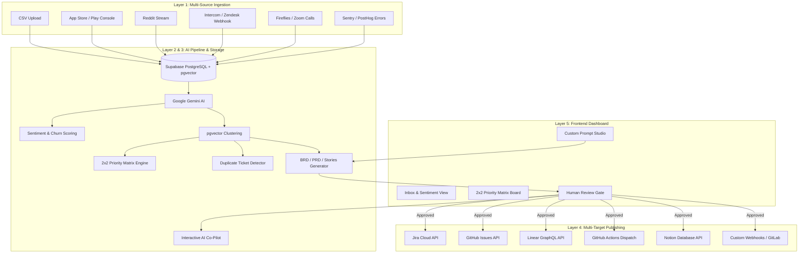

# 🚀 ApeAI — Next-Phase Feature Roadmap & Technical Architecture Design

This document details the architectural design, feature specifications, and step-by-step implementation strategy for the upcoming features of **ApeAI (Automated Product Engineering AI)**.

---

## 📑 Feature Matrix Overview

| Feature Category | Selected Feature | Primary Value Proposition | Targeted Layer |
| :--- | :--- | :--- | :--- |
| **Ingestion Connector** | **App Store & Google Play Reviews** | Ingest public app ratings, reviews, and mobile feedback | Layer 1 (Ingestion) |
| **Ingestion Connector** | **Reddit Subreddit & Keyword Stream** | Capture public community feature requests and complaints | Layer 1 (Ingestion) |
| **Ingestion Connector** | **Intercom / Zendesk Support Webhook** | Ingest customer support conversations & ticket tags | Layer 1 (Ingestion) |
| **Ingestion Connector** | **Fireflies.ai / Zoom Transcript Ingestion** | Extract actionable feature feedback from sales & discovery calls | Layer 1 (Ingestion) |
| **Ingestion Connector** | **Sentry / PostHog Error & Event Connector** | Bridge technical crash logs & user drop-off events with feedback | Layer 1 (Ingestion) |
| **AI Intelligence** | **Sentiment & Churn Risk Weighting** | Score customer frustration and weight issues by customer ARR/tier | Layer 2 & 3 (AI Pipeline) |
| **AI Intelligence** | **Dynamic 2×2 Priority Matrix** | Plot clusters on an Impact vs. Effort matrix for PM roadmap planning | Layer 3 & 5 (AI & UI) |
| **AI Intelligence** | **Duplicate & Related Ticket Detection** | Vector-search existing Jira/Linear backlogs to prevent duplicate specs | Layer 3 (AI Pipeline) |
| **PM Workflow** | **Interactive AI Co-Pilot (Inline PM Assistant)** | Conversational sidebar to refine PRDs/Stories in real time | Layer 3 & 5 (AI & UI) |
| **PM Workflow** | **Custom Prompt Studio & Templates** | Customize prompt formats (Amazon 6-Pager, Agile Standard, Minimal) | Layer 3 (AI Pipeline) |
| **Integrations** | **Extended Exporters (GitHub Actions, Notion, Webhooks)** | Trigger CI/CD workflow dispatch or export PRDs to Notion databases | Layer 4 (Integrations) |

---

## 1. 📥 Layer 1 — External Ingestion Connectors

### 1.1 App Store & Google Play Console Connector
* **Purpose**: Automatically monitor mobile app reviews and star ratings to capture customer dissatisfaction immediately after app updates.
* **How it Works**:
  1. A scheduled cron job or API trigger queries the **Apple App Store Connect API** and **Google Play Developer API** for reviews submitted in the last 24 hours.
  2. Filter reviews with ratings $\le 3$ stars or reviews containing keyword triggers (e.g., *crash*, *slow*, *bug*, *broken*, *missing*).
  3. Normalize the data into the ApeAI unified JSON schema:
     ```json
     {
       "content": "App freezes on OTP verification screen after 2.4.0 update",
       "source": "app_store",
       "author": "User_Mobile_92",
       "metadata": {
         "rating": 1,
         "app_version": "2.4.0",
         "platform": "iOS"
       }
     }
     ```
  4. Dispatch payload to `POST /api/feedback/ingest`.

### 1.2 Reddit Community Connector
* **Purpose**: Scrape target subreddits (e.g., `r/yourproduct`, `r/SaaS`, `r/webdev`) and keyword mentions for public community feedback.
* **How it Works**:
  1. Integrates with the **Reddit API (via OAuth2 / PRAW)** to stream new posts and top comments matching configured search terms or subreddits.
  2. Computes a community engagement weight based on `upvotes` and `comment_count`.
  3. Formats payload with source URL and Reddit username into Layer 1 ingestion.

### 1.3 Intercom / Zendesk Support Webhook
* **Purpose**: Ingest high-friction customer support tickets directly from support desks.
* **How it Works**:
  1. Expose an inbound webhook endpoint: `POST /api/ingest/intercom` and `POST /api/ingest/zendesk`.
  2. Listen for ticket status changes (e.g., `conversation.user.replied` or `ticket.created`).
  3. Extract user message history, customer organization tier (Enterprise vs Free), and tags (`feature-request`, `blocker`).

### 1.4 Fireflies.ai / Zoom Transcript Ingestion
* **Purpose**: Extract customer pain points directly from user interview recordings and sales calls.
* **How it Works**:
  1. Receive `transcript.completed` webhook payload from Fireflies.ai or Zoom Cloud API.
  2. Send transcript raw text to a specialized Gemini extraction prompt: *"Extract discrete customer feature requests, complaints, or workflows mentioned in this call."*
  3. Parse returned array of items and ingest each as an individual feedback item in ApeAI.

### 1.5 Sentry / PostHog Observability Connector
* **Purpose**: Connect technical error logs and analytical user friction (rage clicks, drop-offs) into product requirements.
* **How it Works**:
  1. Receive alert webhooks from **Sentry** (`issue.created`) or **PostHog** (`action.triggered`).
  2. Formats error stack trace summary, impacted user count, and affected endpoint into structured feedback items marked with `source: "sentry"`.

---

## 2. 🧠 Layer 2 & 3 — AI Intelligence & Pipeline Enhancements

### 2.1 Sentiment Analysis & Churn Risk Weighting
* **Objective**: Quantify how upset customers are and prioritize feedback from high-value accounts.
* **Algorithm & Formula**:
  $$\text{Churn Risk Score} = (\text{Sentiment Severity} \times 0.4) + (\text{Customer ARR Tier} \times 0.4) + (\text{Frequency Multiplier} \times 0.2)$$
* **Implementation Details**:
  1. During feedback processing, Gemini scores sentiment severity from `1` (Minor Feedback) to `5` (Critical Frustration / Threat to Cancel).
  2. Map customer metadata (`ARR`, `tier`) stored in Supabase to assign weights:
     * `Enterprise` = 100
     * `Pro` = 50
     * `Free` = 10
  3. Store `sentiment_label` (`Frustrated`, `Neutral`, `Delighted`) and `churn_risk_score` (0–100) in the `feedback` table metadata.
  4. Render visual badges in the frontend Inbox (e.g., 🔥 **HIGH CHURN RISK (88/100)**).

### 2.2 Dynamic 2×2 Priority Matrix (Impact vs. Effort)
* **Objective**: Provide Product Managers with a visual 2D matrix mapping clusters to optimize release planning.
* **Coordinate Calculation**:
  * **Y-Axis (Business Impact Score)**:
    $$\text{Impact} = \text{Normalized Cluster Volume} \times 0.5 + \text{Average Churn Risk Score} \times 0.5$$
  * **X-Axis (Engineering Effort Score)**:
    $$\text{Effort} = \sum (\text{Frontend Points} + \text{Backend Points} + \text{QA Points})$$
* **Matrix Quadrants**:
  ```text
  HIGH IMPACT  ▲ ┌─────────────────────────┬─────────────────────────┐
               │  ⭐ QUICK WINS          │  🚀 MAJOR PROJECTS      │
               │  (High Impact, Low)    │  (High Impact, High)    │
               ├─────────────────────────┼─────────────────────────┤
               │  🧹 FILL-INS            │  ❌ THANKLESS TASKS     │
               │  (Low Impact, Low)     │  (Low Impact, High)     │
  LOW IMPACT   └─────────────────────────┴─────────────────────────┘
               LOW EFFORT ───────────────────────► HIGH EFFORT
  ```
* **Implementation Details**:
  1. Add Express endpoint `GET /api/pipeline/priority-matrix` that fetches clusters, calculates `(x, y)` coordinates, and assigns each cluster to one of the 4 quadrants.
  2. Render an interactive, drag-and-drop 2×2 canvas in Next.js using Tailwind CSS or Recharts / Plotly.

### 2.3 Duplicate & Related Ticket Detection
* **Objective**: Prevent duplicate PRDs and Jira/Linear tickets by searching existing backlogs before generating new specs.
* **Implementation Details**:
  1. When a new cluster is formed, compute its cluster embedding vector.
  2. Perform cosine similarity search via Supabase `pgvector` function `match_tickets` against external published tickets stored in `ticket_links`.
  3. If similarity $> 0.80$, flag the cluster in the UI:
     * ⚠️ *"87% similarity with existing Jira ticket [AUTH-104: Fix OTP Delay]"*.
  4. Give the PM options: **Append to Existing Ticket** OR **Generate New PRD**.

---

## 3. 🛠️ Layer 3 & 5 — PM Workflow & Customization

### 3.1 Interactive AI Co-Pilot (Inline PM Assistant)
* **Objective**: Allow PMs to interactively edit and refine generated BRDs, PRDs, and Stories using a chat sidebar.
* **Implementation Details**:
  1. Build a collapsible `CoPilotDrawer.tsx` component in the frontend review page.
  2. Send user prompt + active document JSON state to backend endpoint `POST /api/pipeline/copilot/refine`.
  3. Express backend passes context to Gemini with system instructions:
     ```text
     "You are an expert technical Product Manager assistant. 
     Modify the provided document JSON according to the user's request: '{user_prompt}'. 
     Maintain strict adherence to the existing JSON schema."
     ```
  4. Return modified document JSON and update state in real time without refreshing the page.

### 3.2 Custom Prompt Studio & Document Templates
* **Objective**: Enable product teams to customize prompt templates for BRD, PRD, and User Story generation.
* **Implementation Details**:
  1. Create a database table `prompt_templates` in Supabase:
     ```sql
     CREATE TABLE prompt_templates (
       id UUID PRIMARY KEY DEFAULT uuid_generate_v4(),
       name VARCHAR(100) NOT NULL,
       template_type VARCHAR(50) NOT NULL, -- 'brd', 'prd', 'story'
       system_prompt TEXT NOT NULL,
       is_default BOOLEAN DEFAULT FALSE,
       created_at TIMESTAMP WITH TIME ZONE DEFAULT NOW()
     );
     ```
  2. Provide pre-built templates:
     * **Amazon 6-Pager Format**
     * **Agile Standard Format**
     * **Minimalist Startup Spec**
  3. Update `backend/src/ai/prompts.ts` to dynamically fetch active template prompts from DB instead of hardcoded strings.

---

## 4. 🔗 Layer 4 — Extended Integration Targets

### 4.1 GitHub Actions Workflow Dispatch
* **Objective**: Trigger automated CI/CD pipelines, boilerplate code generation, or repository provisioning directly from approved technical tasks!
* **Implementation Details**:
  1. Call GitHub REST API endpoint: `POST /repos/{owner}/{repo}/actions/workflows/{workflow_id}/dispatches`.
  2. Pass approved task parameters as workflow inputs:
     ```json
     {
       "ref": "main",
       "inputs": {
         "task_title": "Create OTP retry endpoint",
         "task_type": "backend",
         "story_points": "3"
       }
     }
     ```

### 4.2 Notion Database Exporter
* **Objective**: Export complete PRDs and Epics to Notion workspace databases.
* **Implementation Details**:
  1. Connect to Notion API (`https://api.notion.com/v1/pages`).
  2. Convert Markdown/JSON PRD sections into Notion block objects (`paragraph`, `heading_1`, `to_do_list`, `code`).

### 4.3 Custom Webhooks & GitLab CI Triggers
* **Objective**: Dispatch generic JSON payloads to external webhooks or trigger GitLab pipeline runs (`POST /api/v4/projects/:id/trigger/pipeline`).

---

## 🏗️ Architecture Diagram (Updated)



---

## 🎯 Verification & Testing Strategy

1. **Ingestion Verification**:
   * Mock payloads for App Store, Reddit, Intercom, Transcripts, and Sentry sent via `curl` to `/api/feedback/ingest`.
   * Verify all items are correctly normalized in the `feedback` table.

2. **AI Pipeline Verification**:
   * Verify sentiment labels and churn risk scores are populated in feedback metadata.
   * Test `/api/pipeline/priority-matrix` endpoint to ensure `(x, y)` coordinate outputs match expected quadrant rules.
   * Verify duplicate detection flags overlapping vector clusters.

3. **PM Workflow & Integration Verification**:
   * Test Co-Pilot endpoint with refinement prompts and ensure returned JSON adheres to schema.
   * Dry-run publish requests for GitHub Actions dispatch and Notion API endpoints.
